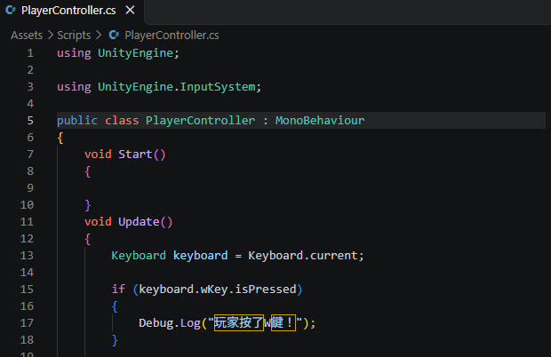
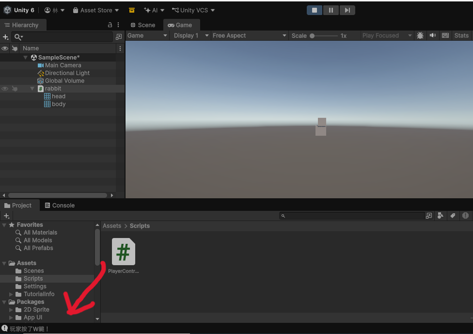
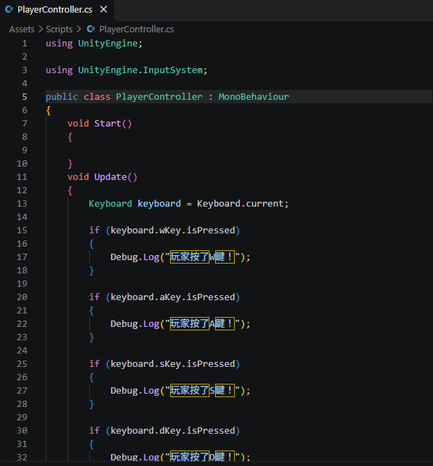

# 第2次練習題目-隨堂-QZ2
>
>學號：113111103
><br />
>姓名：林家妤
><br />
>作業撰寫時間：100min
><br />
>最後撰寫文件日期：2026/11/1
>

本份文件包含以下主題：(至少需下面兩項，若是有多者可以自行新增)
- [x] 說明內容
- [x] 其他 (可以包含心得或是想跟老師反映)

## 說明內容

開始寫說明，該說明需說明想法，
並於之後再對上述想法的每一部分將程式進一步進行展現，
若需引用程式區則使用下面方法，
若為.cs檔內程式除了於敘述中需註明檔案名稱外，
還需使用語法` ```語言種類 程式碼 ``` `，其中語言種類若是要用python則使用py，java則使用java，C/C++則使用cpp，
下段程式碼為語言種類選擇csharp使用後結果：

```csharp
public void mt_getResult(){
    ...
}
```

若要於內文中標示部分網頁檔，則使用以下標籤` ```html 程式碼 ``` `，
下段程式碼則為使用後結果：

```html
<%@ Page Language="C#" AutoEventWireup="true" ...>

<!DOCTYPE html>

<html xmlns="http://www.w3.org/1999/xhtml">
<head runat="server">
<meta http-equiv="Content-Type" ...>
    <title></title>
</head>
<body>
    <form id="form1" runat="server">
        <div>
        </div>
    </form>
</body>
</html>
```
更多markdown方法可參閱[https://ithelp.ithome.com.tw/articles/10203758](https://ithelp.ithome.com.tw/articles/10203758)

請在撰寫"說明程式與內容"該塊內容，請把原該塊內上述敘述刪除，該塊上述內容只是用來指引該怎麼撰寫內容。

1. (需截圖說明，並且需截圖執行結果)

Ans:<br />
第1行程式是指使用Unity引擎的功能。
第3行是在Unity引擎中，匯入nputSystem套件，用來偵測玩家按下了什麼按鍵。
第5行是指這是一個類別(class)，後面是我們在剛開始建立腳本時取的名稱，像現在這個專案測試程式碼主要是要套用到rabbit=玩家，則名稱取自PlayerController(玩家控制器)，而MonoBehaviour是Unity最核心的基底類別，任何自訂的腳本通常都繼承於它，能夠讓腳本作為元件掛載在遊戲物件上(該專案的rabbit)。
第7、11行是預設的函式，void是方法的返回類型(此方法執行後，並不會回傳任何值)，而void start、void update只會執行內部的程式碼邏輯，但執行完即結束，不回傳值到呼喚它的地方。start負責遊戲開始執行一次，常用來初始化變數、update代表每一幀都執行一次，遊戲中的大部分邏輯都在這邊。
第13行是取得目前鍵盤(Keyboard)的狀態。
第15、17行是if偵測到keyboard鍵盤的W鍵被按下，則Console視窗會顯示"玩家按了W鍵!"。
 箭頭指的地方

2. (需截圖說明，並且需截圖執行結果)

Ans:<br />
再來要偵測a、s、d鍵，其實跟上面w鍵一樣，最簡單的方法---複製前面的程式，if 鍵盤 ?key 被按下，則Console視窗會顯示"玩家按了?鍵!"。
不過這邊要注意的就是，複製後一定要記得改 if()裡的?key，不然回到專案執行時，無論按什麼鍵，Console視窗只會顯示最前面的"W鍵被按下"。

## 其他